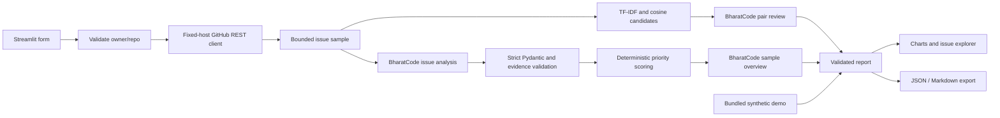

# BharatForge

**Turn a noisy GitHub issue backlog into your next clear action.**

An MIT-licensed, read-only GitHub Issue Intelligence tool built for BharatCode Build League 2026. Python 3.11+ · Streamlit · BharatCode · Pydantic · scikit-learn.

## The problem

Maintainers spend time reconstructing context from overlapping reports, incomplete bug descriptions, and feature requests. A busy backlog makes prioritization difficult even when every issue is valuable.

BharatForge retrieves a bounded sample of the latest open issues, asks BharatCode for evidence-backed estimates, and presents a reviewable backlog briefing. It never changes a repository.

## Features

- Public GitHub repository metadata and latest 10, 20, 30, or 50 open issues, excluding pull requests.
- Issue categories, severity estimates, summaries, user impact, diagnostic clarity, confidence, missing information, and suggested maintainer actions.
- Separate observed facts and inferred conclusions; exact source quotations are checked locally.
- Transparent deterministic priority scoring with component breakdowns.
- TF-IDF/cosine duplicate candidate screening, followed by BharatCode review of up to eight strongest pairs.
- Dark dashboard with category and severity charts, ranked issues, search and filters.
- JSON and safely escaped Markdown exports with mode and model provenance.
- Credential-free bundled demo with ten synthetic issues and mock analysis.
- Timeouts, bounded retries, safe errors, strict Pydantic validation, and mocked automated tests.

## Screenshots

Screenshot placeholders: initial repository form; demo analytics; issue explorer; duplicate review. No screenshots are claimed to exist yet. Run the demo to see the actual application.

## Quick start

From the repository root, install Python 3.11 or newer and create an isolated environment:

```powershell
python -m venv .venv
.\.venv\Scripts\Activate.ps1
python -m pip install -r requirements.txt
Copy-Item .env.example .env
streamlit run app.py
```

On macOS/Linux, use `source .venv/bin/activate` and `cp .env.example .env` instead of the PowerShell activation/copy commands. Open the local URL printed by Streamlit (normally http://localhost:8501).

Select **Try Demo** to load synthetic data. No credentials or external network requests are needed. Demo badges and exports explicitly identify mock analysis. The example repository and issue links are illustrative and may not resolve.

For live analysis, edit `.env` on the server and supply your BharatCode developer key. Restart Streamlit after configuration changes if needed. Enter `owner/repo` or `https://github.com/owner/repo`, choose an issue limit, then select **Analyze Repository**.

### Environment configuration

| Variable | Purpose |
| --- | --- |
| `BHARATCODE_API_KEY` | Required for live mode; obtain from your BharatCode account. |
| `BHARATCODE_BASE_URL` | Defaults to `https://bharatcode.ai/api/model/v1`; restricted to this documented endpoint. |
| `BHARATCODE_MODEL` | Defaults to documented `qwen-3.8-27b`. The client always sends the configured model. Use a model available to your account. |
| `GITHUB_TOKEN` | Optional; improves GitHub rate-limit allowance. Public repositories only. |

Do not commit `.env`, log keys, or paste credentials into issues. Environment values take precedence over dotenv values. No credentials are exported in reports. The app does not accept API destinations in its UI.

### Docker

```sh
docker build -t bharatforge .
docker run --rm -p 8501:8501 --env-file .env bharatforge
```

The image runs as a non-root user. `.dockerignore` excludes local secrets and environments. Docker execution has not been verified in this workspace.

## Architecture



Modules live in `bharatforge/`; `app.py` holds the UI. `examples/sample_issues.json` is a complete synthetic report containing source issues and mock judgments; `examples/generate_demo.py` reproduces it. `examples/sample_report.md` shows a generated export.

## BharatCode integration

Official sources inspected on **11 November 2026**:

- [BharatCode API documentation](https://bharatcode.ai/build)
- [BharatCode Build League](https://bharatcode.ai/hackathon)

The docs confirm bearer authentication, the base URL above, OpenAI-compatible `/chat/completions` and `/responses`, and the model identifiers `qwen-3.8-27b` and `deepseek-v4.1-flash` (the latter requires Pro). They describe student token allowances, shared capacity, queue limits, and retrying busy responses. They do not publish a universal numeric requests-per-minute limit; this project does not invent one. Check the live docs and account model catalog before submission.

The Python OpenAI SDK is a transport client pointed exclusively at BharatCode; OpenAI is not used as an inference provider. Requests use the configured model and server-side key. All inference is through BharatCode, including per-issue analysis, duplicate review, and the backlog overview. No fallback LLM provider is implemented.

The application first uses documented Responses structured output via `text.format` with JSON Schema, `strict: true`, and `store: false`. If BharatCode specifically rejects the structured format with HTTP 400/422, it falls back to the same provider's documented Chat Completions with explicit JSON instructions. Both paths apply the same strict local validation. Malformed or truncated responses are rejected. No unsupported Chat `response_format` flag is assumed. No tools are requested or executed. BharatCode supports application function tools; hosted tools and stored Responses history are unsupported according to the docs.

Inputs are grouped into batches of three issues; issue bodies cap at 12,000 characters, titles at 500, and model payloads at 100,000 characters. Output budgets are 6,000 tokens per issue batch, 1,200 per duplicate review, and 1,800 for the overview. Reasoning is disabled using the documented endpoint-specific reasoning setting. At 50 issues there are at most 26 logical AI requests before retries (17 batches, 8 pairs, 1 overview). Each request has a 90-second timeout and at most three attempts for transport errors, 429, or selected transient 5xx errors. Backoff is exponential, with numeric Retry-After honored up to 30 seconds; longer waits return a safe error. Exhausted output budgets are not retried unchanged. Request attempts and approximate elapsed request time are reported; backoff sleep is excluded from that time. This is not token-usage or billing metering.

Live authenticated BharatCode inference has **not** been verified without user-provided credentials. The SDK request contract and error handling are tested with mocked HTTP. Demo output is never described as real inference.

## Scoring and duplicate review

```text
Priority = 0.40 × Severity + 0.35 × Impact + 0.15 × Diagnostic clarity + 0.10 × Age
Severity: critical=100, high=75, medium=50, low=25
Age = clamp(age_days / 180 × 100, 0, 100)
```

All components clamp to 0–100; the final score is rounded to two decimals. Future-dated issues receive age zero. Scoring uses one UTC timestamp per analysis, so the same inputs and timestamp yield the same result. The dashboard counts scores ≥70 as high priority. This is a **heuristic prioritization estimate, not a verified prediction of business impact**. Severity, impact and clarity are AI estimates, and greater clarity raises priority under the requested formula.

Duplicate screening normalizes title/body text and uses TF-IDF cosine similarity with a configurable default threshold of 0.35. It compares only distinct pairs, then reviews at most eight strongest candidates through BharatCode. Rejected pairs remain visible as likely distinct; failed reviews remain explicitly unconfirmed. Similarity alone is never treated as proof. Pairs are shown individually rather than transitively merged into unsupported duplicate clusters.

## Example

Input: `owner/repo`, latest 20 open issues. A JSON issue entry includes:

```json
{
  "number": 101,
  "category": "bug",
  "severity": "high",
  "summary": "A reported export crash affects CSV data containing emoji.",
  "impact": 85.0,
  "reproducibility": 90.0,
  "confidence": 0.82,
  "observed_facts": ["Export crashes when CSV contains emoji"],
  "inferred_conclusions": ["Maintainer review is needed to confirm scope and impact."],
  "missing_information": ["Stack trace"],
  "suggested_action": "Reproduce the emoji export path and inspect serializer encoding.",
  "evidence": ["Export crashes when CSV contains emoji"]
}
```

This is a **synthetic example**, not a live model result. Full exports nest source issues, analysis, and priority components and include repository metadata, duplicate decisions, overview, warnings, timestamps, model, and mode.

Repository `open_issues_count` includes pull requests. The UI labels this as repository-wide **open items** and separately shows analyzed issue count. It does not present the sample as the full backlog or claim an exact repository-wide issues-only count.

## Tests

```sh
python -m pytest -q
```

Tests mock network calls and cover repository validation, fixed destinations, pagination, PR filtering, empty repositories, rate limits, network failure, score boundaries, duplicate calculations, malformed or truncated model output, issue identity/evidence validation, missing credentials, safe exports, SDK HTTP format, and Streamlit demo/error flows. No live API key is required.

## Verification in this workspace

On 11 November 2026, Python 3.12 validation completed with **60 tests passed**. Streamlit launched on loopback and its health endpoint returned HTTP 200. A live unauthenticated GitHub request retrieved metadata and 10 open issues from `octocat/Hello-World`; oversized text produced a truncation warning. Streamlit AppTest verified the demo and missing-credential recovery, and JSON/Markdown export tests passed. A source scan found no credential patterns.

No authenticated BharatCode call was made. Docker execution, interactive browser layout/screenshot review, and hackathon submission have not been verified. Automated UI tests exercise Streamlit widgets rather than a full browser.

## Security and reliability

- Read-only public repository fetches; no GitHub write operations.
- Validate repository identifiers and construct only official GitHub API URLs. Do not follow redirects or arbitrary pagination links.
- Restrict the AI base URL to BharatCode; keep credentials server-side.
- Treat issue content as untrusted data, isolate it in prompts, and instruct the model to ignore embedded commands. No code, shell commands, or model tool calls are executed.
- Render issue/model text as plain text; only fixed application CSS uses HTML. Markdown exports escape user/model content. Source links are built from validated identifiers.
- Validate all AI output with strict bounded Pydantic schemas; verify issue numbers and exact evidence quotations.
- Bound input, output, pagination, issue count and candidate pairs. GitHub response size is checked after retrieval; this is not a streaming memory limit.
- Reject failed issue batches without replacing a previous successful report. Duplicate/overview failures preserve validated issue results with warnings.
- Never log raw external error bodies, prompts, keys, or model output. No analysis is persisted by the app outside the current Streamlit session; exports are user-initiated.
- Public issue text is sent to BharatCode in live mode. Review provider terms and data handling before analyzing sensitive information. Do not expose this local MVP publicly without authentication and request quotas.

Prompt isolation reduces injection risk but cannot prove that a model follows every instruction. Supporting quotations are verified mechanically; factual interpretation and suggested actions still need maintainer review.

## Limitations and roadmap

Latest-open-issue sampling can omit older or high-impact issues. GitHub pagination stops after 1,000 open items to bound work. Long text is truncated with a warning. No comments, attachments, linked pages, or code are fetched. TF-IDF can miss semantic duplicates or overemphasize repeated templates. Multi-issue semantic clustering, persistent caching, cost dashboards, authenticated deployment, and human feedback are future work.

Requests run synchronously. Large samples and capacity queues may take minutes. Retries are bounded; rate limits may require waiting before another user request. There is no database, job queue, cross-session cache, or automatic background execution. Estimates can be wrong. Docker and live authenticated BharatCode behavior remain unverified until tested with the required environment.

## Contributing and license

See [CONTRIBUTING.md](CONTRIBUTING.md). This project uses the [MIT license](LICENSE).

## Hackathon attribution

Built for **BharatCode Build League 2026**. Powered by BharatCode model inference. The official page requires `BharatCode.txt` at the root of the public default branch; it does not specify exact contents. Our file records the integration and verification status. Publishing and hackathon submission remain the owner's actions. The page inspected on 11 November lists a Round 1 deadline of 10 November 2026, 11:59 PM IST; check organizer updates before submitting.
